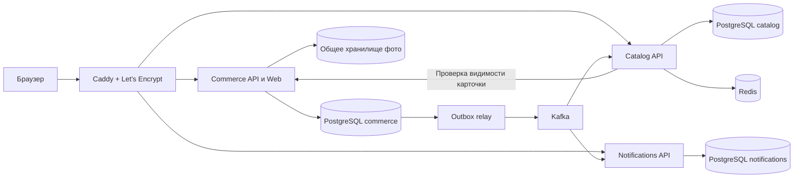

# NeAvito: состояние проекта и план разработки

Дата обследования: 8 ноября 2026 года. Основание: исходный код, миграции, тесты, интерфейс и конфигурация текущего репозитория. Это план дальнейшей разработки, а не отчет о внедрении перечисленных возможностей.

## 1. Результат и границы проекта

Создать площадку покупки и продажи вещей по модели Avito с полноценным оформлением заказа внутри сайта. Один аккаунт может покупать и продавать. Первая версия: русский язык, рубли, физические товары, несколько продавцов в одной корзине, отдельный заказ каждому продавцу.

Обязательный стек: ASP.NET Core, PostgreSQL, Kafka, Redis, Caddy, Let's Encrypt, Kubernetes. Сначала закончить пользовательский путь в существующем приложении, затем выделять сервисы с сохранением работающих сценариев.

Обозначения:

- **Обязательно** — входит в первую завершенную версию.
- **Перед публичным запуском** — можно отложить для закрытой демонстрации, но требуется перед доступом реальных пользователей.
- **Позже** — дополнительное развитие.
- **Заглушка** — явно обозначенная недоступная функция, которая не имитирует успешную операцию.

Оплата, диалоги, рекомендации, расширенная DDoS-защита и дополнительная оптимизация допускают заглушки. Проверка прав, целостность заказов, ограничение загрузок и резервное копирование к необязательной оптимизации не относятся.

## 2. Что действительно есть сейчас

| Область | Реализовано по исходному коду | Что остается |
|---|---|---|
| Приложение | Один ASP.NET Core проект, `net10.0`, контроллеры, EF Core; отдельный проект xUnit | Границы модулей, отдельные процессы, контейнеры и эксплуатация |
| База | PostgreSQL через Npgsql; один `AppDbContext`, шесть миграций | Проверка применения всей цепочки миграций, разделение владения данными |
| Учетные записи | ASP.NET Core Identity, уникальный email, регистрация без автоматического входа, вход/выход, защищенная cookie | Восстановление пароля, подтверждение email, отзыв сессий, блокировка администрацией |
| Защита входа | Пять ошибок входа блокируют аккаунт на 15 минут; cookie на 8 часов со скользящим сроком | Ограничение запросов по нескольким признакам, общие ключи для реплик |
| Профиль | Имя, телефон, адрес; контроль конкурентного изменения | Полный жизненный цикл аккаунта и приватности |
| Каталог | Шесть категорий, поиск подстроки в названии, цены, сортировка, страницы | Город/состояние вещи, отдельная модель чтения, масштабирование поиска |
| Товары | Черновик, публикация/снятие, редактирование только владельцем, версия товара | Архив, причины блокировки, уточнение правил публикации и остатка |
| Изображения | До 10 файлов, перекодирование в WebP, ограничения размеров, доступ с учетом публикации | Общее хранилище для реплик, уборка потерянных файлов, миниатюры |
| Корзина | Серверное хранение, изменение количества, удаление, актуальные цены и предупреждения | Полноценная страница корзины |
| Заказы | Разделение по продавцам, снимки товаров, идемпотентное оформление, отмена с возвратом остатков | Страница оформления/результата, аудит переходов, уточнение пограничных сценариев |
| Интерфейс | HTML/CSS/JavaScript без сборщика: каталог, карточка, вход/регистрация, профиль, товары и история заказов | Корзина, оформление, обработка неопределенного результата покупки |
| Инфраструктура | В Compose только PostgreSQL 17 с постоянным томом | Kafka, Redis, Caddy, TLS, Dockerfile, Kubernetes, CI/CD, мониторинг |
| Тесты | HTTP-тесты на SQLite; два дополнительных теста на PostgreSQL | Обязательный PostgreSQL в CI, миграции, браузерные тесты и отказные сценарии |

Основные точки проверки: `NeAvito/Program.cs`, `Data/AppDbContext.cs`, `Models/*`, `Controllers/*`, `Services/ProductImageStorage.cs`, `wwwroot/app.js`, `wwwroot/catalog.js`, `NeAvito.Tests/*`, `compose.yaml`.

Пределы обследования: код и тестовые сценарии прочитаны; работающее приложение, браузерный путь и пользовательская PostgreSQL-база в этой проверке не запускались. Попытка `dotnet test NeAvito.slnx --no-restore` не дала вывода или итогового результата за время обследования; отправлен сигнал прерывания. Поэтому прохождение тестов сейчас не подтверждено. В P0 необходимо получить воспроизводимый результат сборки и тестов; старые числа из README не используются как свежая проверка.

### Важные особенности и пробелы

1. Покупка сейчас проходит в одной PostgreSQL-транзакции уровня Serializable: создаются заказы, списывается остаток, очищается корзина. Это полезное свойство нужно сохранить.
2. `requestId` уникален в пределах покупателя; сохраняется отпечаток запроса. Совпадающий успешный повтор возвращает старый результат, другой состав с тем же ключом запрещен.
3. Версия позиции корзины отличается от версии товара. Интерфейс оформления должен отправлять именно версию позиции.
4. Покупка собственных товаров явно не запрещена в контроллерах корзины и оформления. Ввести запрет на обоих уровнях.
5. Число разных товаров в корзине сейчас не ограничено отдельным бизнес-правилом, хотя запрос оформления ограничен 1000 позициями. Установить согласованный предел.
6. При возврате остатков возможен конфликт переполнения `int`, который уже обрабатывается. Согласовать верхнюю границу остатков и запретить ее обход через редактирование.
7. Операции публикации и изменения статуса заказа не принимают ожидаемую клиентскую версию. Серверная конкуренция защищена, но действие из давно открытой страницы требует отдельного решения.
8. Профиль продавца подтягивается из Identity через общий контекст. При выделении каталога эту связь надо заменить публичной проекцией.
9. Фотографии лежат на локальном диске приложения. Несколько реплик с независимыми дисками работать корректно не будут.
10. Ключи Data Protection явно не вынесены в общее постоянное хранилище. Перезапуски контейнеров и несколько реплик требуют этого до масштабирования.
11. Нет явно настроенных forwarded headers, health endpoints, rate limiting, ограниченного списка production-хостов, контейнеров и конвейера выпуска.
12. Все API и изображения имеют `no-store`. Это безопасная исходная политика; кеширование нужно вводить адресно с учетом снятия товара с публикации.
13. PostgreSQL-тесты создают схему через `GenerateCreateScript()`. Они проверяют работу текущей модели, но не доказывают работоспособность последовательности EF-миграций.
14. README содержит исторические заявления о выполненных проверках, абсолютный путь другого компьютера и упоминание RabbitMQ. Обновить документацию под Kafka и воспроизводимые команды; не считать старые заявления результатом сегодняшнего запуска.

## 3. Принятые продуктовые решения

Следующие решения предлагаются как базовые, чтобы разработку можно было начинать без дополнительных согласований. Изменения фиксировать отдельным решением с обновлением сценариев и тестов.

| Вопрос | Решение первой версии |
|---|---|
| Магазин или доска объявлений? | Маркетплейс: карточка вещи → корзина → заказ → подтверждение продавца → завершение |
| Роли | Гость; пользователь с возможностью покупать/продавать; отдельно администратор |
| Продажа своих вещей | Покупать собственный товар нельзя |
| Количество | По умолчанию 1, разрешены одинаковые экземпляры; варианты размера/цвета — отдельные товары |
| Деньги | RUB; внутри БД — целые копейки; существующий API с decimal-рублями сохранить |
| Способ оплаты | «По договоренности с продавцом; сайт не принимает оплату» |
| Получение | «По договоренности»; адрес/место передачи и контакты сохраняются в заказе; доставка не рассчитывается |
| Корзина гостя | Не сохраняется; для добавления нужен вход |
| Оформление | Весь текущий состав корзины, все или ничего; выбор отдельных позиций — позже |
| Лимит корзины | 100 различных товаров, 1–10000 единиц каждой позиции в пределах остатка |
| Отмена | Покупатель и продавец могут отменить New/Confirmed; повтор не возвращает остаток снова |
| Завершение | Продавец отмечает передачу; Completed не означает подтвержденную онлайн-оплату |
| Автоотмена | В первой версии отсутствует; зависшие заказы видны продавцу, сроки и напоминания — позже |
| Удаление товара | Архивирование; история заказов сохраняется |
| География | Не ограничивать покупки регионом; город продавца — фильтр и информация, не тариф доставки |
| Комиссии/торг/возвраты | Не реализуются автоматически; условия передачи и оплаты согласуются участниками |

## 4. Подробные правила пользовательских сценариев

### 4.1. Регистрация, вход и аккаунт

1. Поля регистрации: имя 1–100 символов после trim, email до 256, пароль 8–128. Явно показать правила Identity: длина, цифра, заглавная/строчная буква и небуквенный символ, если эти настройки сохранены.
2. Не обрезать пароль и не менять его регистр. Email нормализовать средствами Identity, уникальность закрепить в БД; проверить одновременную регистрацию одного адреса.
3. После регистрации показать успех и форму входа; автологин не вводить без изменения тестов и интерфейса.
4. Ошибка входа одинаковая для неверного пароля, отсутствующего аккаунта и временной блокировки; не возвращать детали учетной записи.
5. После входа вернуть пользователя на исходную безопасную внутреннюю страницу. Внешний `returnUrl` запрещен. Добавление товара после входа выполняется осознанным действием пользователя.
6. При 401 сохранить несекретные введенные данные формы в памяти вкладки, предложить вход, после него обновить цены и доступность. Нельзя автоматически повторять покупку с новым ключом.
7. Выход завершает текущую сессию; «выйти на всех устройствах» отозвать отдельно. Вкладки после выхода очищают приватные данные и счетчики.
8. Перед публичным запуском: подтверждение email, одноразовые ограниченные по времени ссылки сброса пароля, одинаковый ответ для существующего/несуществующего email, лимиты отправки. После сброса отозвать старые сессии. Секретные ссылки не писать в общие логи.
9. В закрытой демонстрации разрешен тестовый почтовый приемник. Кнопка сброса без почтового канала должна сообщать, что функция недоступна.
10. Заблокированный пользователь не создает товары и заказы; уже существующие заказы остаются доступными в ограниченном режиме для урегулирования. Проверка блокировки должна выполняться сервером, а не только интерфейсом.

### 4.2. Профиль и разделение доступа

- Изменяются имя, телефон, адрес; email в первой версии только для чтения.
- Имя продавца публично; email, телефон и адрес не выдаются каталогом.
- Получатель заказа может отличаться от владельца аккаунта. Изменение профиля не меняет уже оформленные заказы.
- Продавец видит контакты только в собственных заказах; покупатель — свои заказы. Для чужого объекта возвращать 404.
- Добавить согласованный контакт продавца в снимок заказа: обязательный телефон профиля перед публикацией, копирование в заказ, доступ только покупателю и продавцу. Иначе при отключенном чате покупатель не сможет связаться с продавцом.
- При конфликте версии профиля показать актуальные данные и предложить повторное сохранение; не затирать автоматически чужое изменение.
- Администратор не регистрируется через публичный выбор роли. Создание администратора — отдельная защищенная операция без пароля по умолчанию.

### 4.3. Товары и остатки

Сохранить существующие поля и ограничения: название до 200, описание до 10000, цена 0,01–1 000 000 000 рублей с точностью до копейки, существующая категория. Цена и количество обязательны; пробельные значения отклоняются.

Добавить поля `Condition` (New/Used), `City` (до 100), `UpdatedAtUtc`, `ArchivedAtUtc`. Для существующих товаров не выдумывать город/состояние: разрешить пустое значение до следующего редактирования; перед новой публикацией требовать заполнения. Автоматически не снимать старые товары без отдельного решения о миграции.

Жизненный цикл:

- Draft → Published, если валидны поля и контакт продавца.
- Published → Unpublished; повтор снятия допустим.
- Unpublished → Published после проверки.
- Draft/Published/Unpublished → Archived с исключением из продажи.
- Archived → Draft через явное восстановление владельцем.
- Административная блокировка хранится отдельно с причиной; продавец не может снять ее обычной публикацией.

Фото необязательно: карточка без фото получает аккуратную заглушку. Остаток 0 разрешен, товар виден как недоступный. Начальный предел остатка предлагается 1 000 000 единиц; при миграции сначала найти существующие превышения, не обрезать их молча.

`Stock` обозначает доступное для новой покупки количество. Оформление уменьшает его сразу, отмена возвращает. Продавцу интерфейс объясняет, что это доступный остаток, без уже оформленных экземпляров. Позже заменить абсолютное редактирование остатка операциями поступления/корректировки с журналом.

Любое изменение цены, публикации, фото и остатка обновляет версию товара; клиентские изменения публикации/архива также передают ожидаемую версию. Повтор уже достигнутого состояния допустим; несовпадение версии при фактическом изменении — 409.

Скрытие/архивирование не отменяет существующие заказы. Отмена такого заказа возвращает остаток, но не публикует товар. Физическое удаление товара, на который ссылается заказ, не допускается.

### 4.4. Изображения

- Сохранить проверку содержимого: JPEG/PNG/WebP, до 5 МиБ, максимум 12 мегапикселей и 6000 пикселей по стороне, одна статичная картинка, до 10 на товар.
- Сначала проверять доступ и лимиты, затем декодировать; ограничить одновременную обработку тяжелых изображений.
- Удалять метаданные, корректно применять ориентацию фото; исходное имя не использовать как путь.
- Добавить главную фотографию и перестановку с проверкой полного списка уникальных принадлежащих товару ID и версии товара.
- Загрузка файла и запись БД не образуют общую транзакцию: хранить временный файл, финализировать после записи, периодически удалять сироты старше защитного интервала. При сбое удаления выполнять повтор из очереди.
- На первом стенде — один процесс записи и постоянный том; до нескольких реплик выбрать общее RWX-хранилище либо S3-совместимое хранилище через интерфейс `IImageStorage`.
- Не открывать весь каталог хранения как публичную статику. Проверка видимости скрытых фотографий сохраняется. При дальнейшем CDN-кеше отдельно определить срок доступности после снятия публикации.
- Ошибка чтения файла дает заглушку в интерфейсе и диагностическую запись, не ломает страницу товара.

### 4.5. Каталог и поиск

1. Гость и пользователь видят опубликованные, не заблокированные и не архивные товары. Нулевой остаток — видимый статус «Нет в наличии»; фильтр «Только доступные» включается явно.
2. Фильтры комбинируются через AND: текст, категория, нижняя/верхняя цена, город, состояние, наличие. Новые фильтры вводить после новых полей.
3. Строка поиска обрезается по краям, максимум 200 символов; пустая равна отсутствию фильтра. Первая версия сохраняет поиск подстроки по названию без учета регистра; морфология и опечатки не обещаются.
4. Сортировки сохранить: новые, старые, цена вверх/вниз; второй ключ — ID. Страница 1+, размер до 100, интерфейс 12. При изменении фильтра сбрасывать страницу на первую.
5. Фильтры сохраняются в URL; назад из карточки восстанавливает выдачу. Запоздалый ответ старого поиска не перезаписывает новый.
6. Отдельные состояния: загрузка, пустая база, нет совпадений, ошибка, товар снят с публикации. Для ошибки — повтор, для пустой выдачи — сброс фильтров.
7. Результаты отдельного Catalog Service обновляются с небольшой задержкой. Проверка покупки всегда идет по основной базе Commerce. Для снятия публикации и блокировок карточка/изображение проходят актуальную проверку видимости; при недоступности этой проверки скрытые данные не выдавать.
8. В выдаче проекции допускается краткая задержка исчезновения карточки; целевое время 5 секунд при исправной Kafka. Для строгого немедленного удаления потребуется пакетная проверка видимости результатов перед ответом — отдельная задача перед публичным запуском, если выбран такой SLA.

### 4.6. Корзина

1. Корзина принадлежит аккаунту и хранится в PostgreSQL; Redis не становится единственным хранилищем.
2. «В корзину» устанавливает количество 1 только для отсутствующего товара; существующее количество сохраняется. Интерфейс не должен незаметно заменять 5 на 1.
3. Количество целое, 1–10000 и не больше актуального остатка; 0 не означает удаление, для удаления отдельная кнопка.
4. Ввести предел 100 разных товаров и запрет собственных товаров на сервере. Существующие сверхлимитные корзины разрешить читать/сокращать, но не расширять и не оформлять до приведения к лимиту.
5. Сохранять цену при первом добавлении до удаления позиции. После удаления и нового добавления фиксировать новую исходную цену.
6. Добавление не резервирует остаток. Изменение цены, снятие публикации и нехватка не удаляют позицию автоматически.
7. Показывать товары по продавцам, цену за единицу, количество, сумму позиции, текущую доступность, старую и новую цену при изменении.
8. Общая сумма и сумма полностью доступных позиций подписаны по-разному. При любой недоступной позиции оформление блокируется; частичный заказ не формируется молча.
9. Каждое изменение возвращает пересчитанную корзину. Ошибка изменения количества откатывает визуальное предположение и показывает актуальный остаток.
10. Для нескольких вкладок добавить ожидаемую версию к изменению количества. Первый запрос добавления без версии; конфликт существующей позиции — обновить и предложить повтор. Удаление повторяемо.
11. Кнопка очистки требует локального подтверждения пользователя. После выхода содержимое не показывается следующему вошедшему аккаунту.

### 4.7. Оформление заказа

Форма содержит получателя, телефон, адрес/место передачи, согласованный способ «По договоренности», состав по продавцам и итог. Значения профиля — исходные подсказки, их можно изменить только для заказа. Стоимость доставки не включена и прямо обозначена как несогласованная; не показывать фиктивную «бесплатную доставку».

Алгоритм:

1. Получить свежую корзину и показать покупателю итоговые цены. При пустой/недоступной корзине не открывать подтверждение.
2. Проверить контакты на клиенте и повторно на сервере. Телефон нормализовать по выбранным правилам, не заявлять, что синтаксическая проверка подтверждает владение номером.
3. Сформировать `requestId` один раз для подтвержденного снимка. Передать все позиции с количеством, ценой и версией позиции корзины.
4. На сервере проверить принадлежность, запрет собственной покупки, состав, версии, цены, статусы и остатки. Не доверять итоговой сумме браузера.
5. Одной транзакцией сохранить `CheckoutBatch`, заказы по продавцам, снимки названий/цен/контактов, списать остатки, удалить оформленные позиции, записать события Outbox.
6. Любая невалидная позиция отменяет всю транзакцию. Покупатель видит конкретные изменения; после повторного согласия создается новый ключ.
7. Успех — 201 с заказами; точный повтор успешного запроса — 200 с теми же ID. Двойной клик и два параллельных одинаковых запроса не создают вторую покупку.
8. При таймауте/разрыве связи результат неизвестен: показать «Проверяем оформление», сохранить прежний ключ и отправить прежний запрос либо запросить состояние по ключу. Не предлагать сразу новый заказ.
9. Добавить `GET /api/orders/checkouts/{requestId}` только для владельца: найденный результат или 404 «успешное оформление пока не найдено». Сам по себе 404 не доказывает, что параллельная транзакция не завершится; безопасен повтор прежнего ключа.
10. В пределах срока сессии хранить в sessionStorage ключ, ID/версии/цены позиций для восстановления неопределенного результата; контакты и пароли туда не записывать. Если исходного тела больше нет, сначала проверять результат, затем явно восстанавливать сценарий.
11. После успеха обновить счетчик корзины и открыть страницу с полными номерами заказов, продавцами, контактами для связи и переходом в историю.
12. Отпечаток запроса рассчитывается по нормализованным полям в фиксированном порядке. Порядок позиций не влияет. Сохранить уникальность `(BuyerId, RequestId)` и не удалять историю ключей раньше заказа.

Разделить причины конфликтов: `CART_CHANGED`, `PRICE_CHANGED`, `OUT_OF_STOCK`, `PRODUCT_UNAVAILABLE`, `OWN_PRODUCT`, `REQUEST_ID_REUSED`, `CONCURRENT_CHANGE`. Не оставлять одну инструкцию одновременно «обновите состав» и «повторите старый запрос»: при неопределенном результате повторяют старый запрос, при доказанном изменении условий сначала получают новое согласие.

### 4.8. Заказы и отмена

| Исходный статус | Действие | Кто | Результат |
|---|---|---|---|
| New | Подтвердить | Продавец | Confirmed |
| Confirmed | Завершить передачу | Продавец | Completed |
| New/Confirmed | Отменить | Покупатель или продавец | Cancelled и однократный возврат остатка |
| Любой | Повтор текущего статуса | Участник с правом соответствующего действия | Текущее состояние без новых побочных эффектов |
| Completed/Cancelled | Изменить на другой | Никто в штатном API | 409 |

Добавить историю: старый/новый статус, время UTC, автор, причина отмены до 500 символов, версия. Переход, возврат остатка, история и Outbox сохраняются в одной транзакции. Конкурирующие завершение и отмена разрешаются одной победившей транзакцией; проигравшему показать актуальное состояние.

Карточки покупателя и продавца показывают полный номер, дату в локальном часовом поясе, неизменяемый состав, способ получения/расчета, контакты участников и разрешенные действия. В списках — пагинация и фильтр статуса. Переходы проверяются сервером независимо от доступных кнопок.

Не менять цену/состав существующего заказа редактором товара. Изменение сделки — отмена и новое оформление. Частичные отмены, возвраты после передачи, арбитраж и платежные споры — отдельный будущий контур.

## 5. Целевая многосервисная архитектура

### 5.1. Минимальная законченная архитектура

Первый многосервисный выпуск состоит из трех независимо запускаемых приложений. Это осознанная граница: дробление заказов и остатков сразу потребует распределенного процесса покупки.

| Компонент | Ответственность | Собственные данные |
|---|---|---|
| Commerce API + текущий Web | Identity, профиль, команды товаров, изображения, корзина, оформление и статусы | `commerce`: пользователи, товары, категории-источник, остатки, корзины, заказы, Outbox |
| Catalog API | Публичный список/поиск и модель чтения; обновление из Kafka | `catalog`: публичные проекции товаров/продавцов/категорий, Inbox |
| Notifications Worker + API | Внутрисайтовые уведомления о заказах; опционально почта | `notifications`: Inbox, уведомления, попытки отправки |
| Caddy | Внешний HTTPS, маршрутизация, статические файлы по согласованной схеме | Постоянное хранилище сертификатов |
| Kafka | Передача событий Commerce другим сервисам | Топики и offsets |
| Redis | Восстанавливаемый кеш публичного каталога, дополнительные счетчики лимитов | Только временные данные |

Каждый сервис — отдельный контейнер, конфигурация, health endpoints и жизненный цикл. Один физический PostgreSQL на первом стенде допустим, но базы/учетные записи сервисов разные. Сервисы не читают чужие таблицы. Commerce сохраняет собственную транзакционную базу.

Outbox relay — фоновый компонент Commerce с доступом только к его базе; можно запускать отдельным worker-процессом. Caddy — входной прокси, не место бизнес-авторизации.

### 5.2. Авторизация между сервисами

На первом разделении сохранить cookie для браузера и единый origin. Commerce остается владельцем Identity. Для приватного Notifications API использовать проверку сессии через внутренний endpoint Commerce с аутентификацией сервиса; не доверять входному `X-User-Id`. Этот простой вариант добавляет зависимость, но не требует собственного протокола выпуска токенов. При недоступности проверки возвращать 503, не открывать данные.

Публичному Catalog API cookie не нужна для списка. Изображения, карточки владельца и операции продавца остаются в Commerce. Внутренние endpoint'ы не публиковать через Caddy; service credentials хранить в Secrets, ротировать, ограничивать NetworkPolicy.

### 5.3. Следующее разделение при необходимости

После устойчивой первой версии выделить Identity Service и Web/BFF. Использовать проверенную реализацию OIDC/OAuth2; ASP.NET Core Identity сам по себе не является готовым OIDC-сервером. BFF хранит серверную сессию, браузер получает HttpOnly cookie; access/refresh tokens не хранить в localStorage. API проверяют issuer, audience, signature, срок и права.

Перенести Identity-таблицы с сохранением ID и password hashes, убрать межбазовые FK на пользователя, создать публичные проекции имен. Профиль остается источником персональных данных в Identity. Заказы хранят снимки. Переключение допускает явно объявленный повторный вход; не обещать перенести старые cookie автоматически.

Выделение Inventory и Orders — поздний этап. Перед ним нужен проект саги: резерв с TTL в PostgreSQL, идемпотентное подтверждение/освобождение, состояние Pending, компенсации частично созданных заказов и сверка зависших резервов. Истечение ключа Redis не является надежным механизмом отмены резерва. До такого проекта не разрывать нынешнюю транзакцию.

## 6. Kafka: конкретные контракты и обработка сбоев

События являются следствием успешно сохраненного состояния; синхронный HTTP-ответ покупки не зависит от доступности Kafka.

| Топик v1 | Ключ | События | Потребители |
|---|---|---|---|
| `neavito.product-events.v1` | productId | ProductUpserted, ProductVisibilityChanged, ProductStockChanged, ProductArchived | Catalog |
| `neavito.order-events.v1` | orderId | OrderCreated, OrderStatusChanged | Notifications |
| `neavito.seller-events.v1` | sellerId | SellerPublicProfileChanged | Catalog |
| `neavito.category-events.v1` | categoryId | CategoryChanged | Catalog |

Конверт: `eventId`, `eventType`, `schemaVersion`, `aggregateId`, `aggregateSequence`, `occurredAtUtc`, `correlationId`, `payload`. GUID `Version`, существующий в моделях, не задает порядок: добавить отдельный монотонный номер события агрегата в той же транзакции.

Полезная нагрузка товара содержит только публичные данные и полный актуальный снимок, чтобы проекция могла восстановиться после пропуска промежуточного обновления. События заказа содержат ID участников, номер и статус; адреса и телефоны не распространять по всем топикам. За нужными приватными данными consumer обращается в авторизованный API по необходимости.

Правила реализации:

1. `OutboxMessage`: ID, агрегат/sequence, тип/версия, payload, CreatedAt, PublishedAt, Attempts, NextAttemptAt, LeaseUntil, LastError. Запись рядом с изменением заказа/товара в одной транзакции.
2. Relay выбирает пачку с блокировкой/арендой, отправляет и отмечает доставку после подтверждения брокера. Сбой между отправкой и отметкой дает дубликат — это нормальный сценарий.
3. Сохранять порядок отправки для одного агрегата; не допускать параллельного обхода заблокированной предыдущей записи того же агрегата. Порядок в Kafka гарантирован в пределах партиции, не всех топиков.
4. У каждого consumer таблица Inbox с уникальным `(consumer, eventId)`. Изменение проекции и Inbox — одна транзакция; offset фиксируется после нее.
5. Проекция не применяется поверх более новой sequence. Пропуск последовательности обнаруживается; для полного снимка можно применить новую версию, для зависимого события — запросить сверку.
6. Сетевые ошибки: ограниченные повторы с увеличением интервала и jitter. Некорректное событие после лимита — DLQ с типом ошибки и ссылкой на исходное событие; алерт оператору.
7. Replay DLQ — управляемая команда после устранения причины, с прежним eventId. Для заказов нельзя пропускать критичный переход без сверки; уведомление формулировать так, чтобы запоздалое событие не выдавало старый статус за актуальный.
8. Изменения схемы сначала добавочные. Несовместимые изменения — новый тип/версия с периодом совместимости. Зафиксировать JSON Schema и контрактные тесты.
9. Предлагаемый retention обычных событий — 7 дней, DLQ — 14 дней без персональных данных; это настройки стенда, затем уточняются по диску и восстановлению. После такого окна использовать полный snapshot источника, а не надеяться восстановить все только из Kafka.
10. Начальная загрузка Catalog: snapshot с версиями и обработка событий с дедупликацией; включить consumer до/во время выгрузки, чтобы не потерять изменения между snapshot и переключением. Перестроение делать в новой проекции, сверить количество/версии, переключить атомарно.
11. Для dev достаточно одного брокера KRaft; это не отказоустойчивость. Для отказоустойчивого production спроектировать минимум три брокера/репликацию, `acks=all`, подходящий min ISR и отдельную надежность controller quorum.

Kafka-транзакции не объединяют запись в PostgreSQL и публикацию в брокер. Поэтому нужны Outbox и дедупликация потребителей; основание — [семантика доставки Apache Kafka](https://kafka.apache.org/40/design/design/).

## 7. Redis и поведение при недоступности компонентов

Redis использовать по схеме cache-aside. Ключ включает версию схемы, нормализованные фильтры, сортировку, страницу и размер. Не включать cookie или приватные данные. Начальный TTL выдачи — 30 секунд с небольшим случайным разбросом, категорий — 5 минут; значения уточняются замерами.

События изменения товара инвалидируют соответствующий кеш; TTL остается страховкой пропущенной инвалидации. Чтобы отложенный запрос не записал старую выдачу после очистки, применять поколение кеша или повторную проверку версии. Сдерживать одновременный пересчет популярных ключей. Не создавать неограниченное число ключей для произвольных поисковых запросов.

| Отказ | Ожидаемое поведение |
|---|---|
| Redis | Ограниченный обход кеша в PostgreSQL; торговые данные не теряются; локальные защитные лимиты остаются |
| Kafka | Покупки сохраняются вместе с Outbox; каталог/уведомления запаздывают; алерт по возрасту очереди и месту на диске |
| Commerce PostgreSQL | Запись/оформление возвращают 503; никакого «успеха» из кеша; liveness остается живым |
| Catalog | Показать недоступность поиска и повтор; историю заказов/личный кабинет не выключать |
| Notifications | Покупка не блокируется; уведомления догоняют после восстановления |
| Хранилище изображений | Загрузка не подтверждается; карточки используют заглушку; заказы доступны |
| Identity/проверка сессии | Приватные операции закрыты; публичный каталог по возможности доступен |

Не делать Redis-блокировку единственной защитой продажи последнего экземпляра. Источник истины — ограничения, версии и транзакции PostgreSQL.

## 8. Необязательные функции и честные заглушки

| Возможность | Первая версия | Развитие |
|---|---|---|
| Онлайн-оплата | `paymentMethod=ByAgreement`, `paymentStatus=NotProcessed`; текст «Сайт не принимает оплату» | Отдельный Payment Service, провайдер, webhook с проверкой подписи, идемпотентность, сверка и возвраты |
| Чат | Кнопку скрыть либо показать «Чат пока недоступен»; контакты доступны после заказа | Участники, история, антиспам, блокировки, вложения, доставка/прочтение, SignalR |
| Рекомендации | Скрытый блок либо «Похожие товары» из той же категории; без заявления о персонализации | События просмотров с учетом приватности, ранжирование, измерение результата |
| DDoS | Базовые лимиты запросов/тел/файлов/таймаутов | Защита на стороне провайдера/CDN/WAF и закрытие прямого origin |
| Оптимизация | Индексы, пагинация, ограниченные запросы, базовый Redis-кеш | Полнотекстовый поиск, миниатюры, CDN, cursor pagination, горизонтальное масштабирование по замерам |

Заглушки включаются feature flags. Недоступный endpoint возвращает стабильный `FEATURE_DISABLED`, а не фиктивный успешный платеж/отправленное сообщение. Если позже появится оплата, состояние заказа и состояние платежа хранятся отдельно. Возврат из браузера от провайдера сам по себе не подтверждает оплату.

## 9. Общие API-контракты и модель данных

Сохранить нынешние `/api/*` на время перехода. Вынести DTO из контроллеров; доменные EF-сущности не отдавать напрямую и не использовать как общую библиотеку всех сервисов.

Ошибки привести к Problem Details с `status`, `code`, `title`, `traceId`, `errors` и безопасными деталями конфликта. 400 — валидация; 401 — нет входа; 403 — действие запрещено; 404 — нет/не доступен объект; 409 — конфликт; 413 — размер; 429 — лимит с Retry-After; 503 — временная недоступность. Сначала обновить клиентский парсер ошибок, затем серверные ответы.

Новые/расширенные операции:

- `GET /api/orders/checkouts/{requestId}` — восстановление результата.
- Публикация/архив/изменение статуса заказа — ожидаемая версия в теле.
- Перестановка фотографий — список ID и версия товара.
- Уведомления: список по владельцу, непрочитанное количество, отметить прочитанным; повтор идемпотентен.
- Административные скрытие товара/блокировка пользователя — отдельные права, причина и аудит.
- `/health/live`, `/health/ready`, защищенная точка метрик.

Новые данные:

| Модель | Поля/ограничения |
|---|---|
| Product | Condition, City, UpdatedAtUtc, ArchivedAtUtc, ModerationState, EventSequence |
| Order | PaymentMethod/Status заглушки, DeliveryMethod, SellerContactSnapshot, EventSequence |
| OrderStatusHistory | OrderId, From, To, ActorId, Reason, CreatedAtUtc; индекс по OrderId/времени |
| OutboxMessage | Индекс очереди неопубликованных по NextAttemptAt; уникальность eventId |
| InboxMessage | Уникальность consumer/eventId; дата обработки |
| CatalogProduct | Только публичные поля; SourceSequence, ProjectedAtUtc, индексы под фильтры |
| Notification | UserId, EventId, Type, OrderId, CreatedAt, ReadAt; уникальность пользователя/события/типа |
| AuditEntry | Действие, объект, исполнитель, результат, время; без паролей и полных секретов |

Даты внутри системы UTC; клиент локализует. Все ID и суммы проверяются сервером. Удаление аккаунта не должно каскадно удалять историю покупок: перед публичным запуском определить анонимизацию, сроки хранения и обязанности владельца сервиса отдельно для выбранной юрисдикции.

## 10. Caddy, Let's Encrypt и контейнеризация

1. Сделать multi-stage Dockerfile для ASP.NET и `.dockerignore`; контейнер без root, секретов и dev-сертификатов внутри образа.
2. Compose расширить приложениями, Kafka, Redis, Caddy, томами и healthchecks. Базы/брокер не публиковать наружу; локальные диагностические порты привязать к loopback.
3. Внешний трафик идет через Caddy. Явные правила: auth/profile/cart/orders/seller/images → Commerce; каталог → Catalog; уведомления → Notifications; остальная статика → Web.
4. Для публичного домена настроить DNS, доступность ACME challenge и issuer Let's Encrypt. Для localhost использовать dev-сертификат/локальный CA; публичный сертификат для localhost не планировать.
5. Сначала ACME staging, затем production; хранить Caddy data на постоянном томе, не терять аккаунт/ключи при выпуске. Caddy сам управляет выпуском и обновлением; второй независимый автоматический менеджер тех же сертификатов не нужен. Основание: [Automatic HTTPS](https://caddyserver.com/docs/automatic-https) и [настройка TLS](https://caddyserver.com/docs/caddyfile/directives/tls).
6. В ASP.NET настроить доверенные forwarded headers до HTTPS redirect/auth, указать только реальные доверенные прокси/сети; ограничить AllowedHosts. Проверить, что нельзя подделать клиентский IP или схему извне. См. [документацию ASP.NET Core о прокси](https://learn.microsoft.com/en-us/aspnet/core/host-and-deploy/proxy-load-balancer?view=aspnetcore-10.0).
7. На стенде проверить secure-cookie, вход/выход, отсутствие циклического HTTPS redirect и редиректа на внутренние адреса.
8. Общий постоянный Data Protection key ring для реплик Commerce с одинаковым ApplicationName; защитить ключи, включить их в план восстановления. Redis-кеш с вытеснением не выбирать единственным хранилищем этих ключей. См. [ASP.NET Core в нескольких экземплярах](https://learn.microsoft.com/en-us/aspnet/core/host-and-deploy/web-farm?view=aspnetcore-10.0).

## 11. Kubernetes: первый стенд и публичная среда

Первый стенд — воспроизводимый локальный кластер, отдельный namespace. Конфигурацию хранить в `deploy/k8s/base` и overlays `dev/staging/prod` через Kustomize. Не внедрять одновременно Helm и Kustomize без причины.

Обязательные манифесты:

- Deployment/Service для каждого API/worker; ConfigMap для несекретных настроек; Secret через защищенный механизм доставки.
- Requests/limits по CPU/RAM и ограничение временного диска; исходные значения проверить нагрузкой, не объявлять универсальными.
- Startup/readiness/liveness probes. Liveness проверяет процесс, readiness — критичные зависимости конкретного сервиса. Kafka и Redis не должны убирать Commerce из балансировки, если торговая транзакция еще может безопасно завершаться. См. [назначение probes](https://kubernetes.io/docs/concepts/workloads/pods/probes/).
- Graceful shutdown: перестать брать запросы/сообщения, закончить ограниченные по времени операции, не подтверждать незавершенные offsets.
- Постоянные тома для PostgreSQL, Kafka, файлов и Caddy; Redis-кеш допускает потерю. StatefulSet сам по себе не организует репликацию БД; см. [StatefulSets](https://kubernetes.io/docs/concepts/workloads/controllers/statefulset/).
- NetworkPolicy с закрытием по умолчанию и точечными разрешениями, включая DNS; выбрать CNI, который реально исполняет эти правила. См. [Network Policies](https://kubernetes.io/docs/concepts/services-networking/network-policies/).
- ServiceAccount с минимальными правами, без автоматического доступа приложения к API кластера, non-root и read-only root filesystem с явными writable volumes.
- Миграции отдельным Job перед совместимым выпуском; не запускать одновременно из каждой реплики.
- Два экземпляра API только после общих ключей, хранилища фото и безопасного worker locking. Для них — rolling update и PDB, если есть ресурсы и несколько узлов.

Caddy на первом стенде: одна реплика с PVC и стратегией обновления, совместимой с томом; LoadBalancer/NodePort зависит от среды. Это точка отказа, допустимая для демо. Для публичной высокой доступности нужны несколько входных узлов и совместимое общее хранилище Caddy либо явно другая схема управления сертификатами. Не умножать Caddy с независимыми томами и не считать сертификаты решенной задачей.

PostgreSQL/Kafka в учебном кластере могут быть одиночными. Для production выбрать управляемые сервисы либо профильные операторы, резервирование дисков и проверенное переключение. Kubernetes не заменяет резервные копии и не создает отказоустойчивость на одном компьютере.

## 12. Безопасность, наблюдаемость и резервное копирование

### Базовая защита

- Сохранить HttpOnly/Secure cookie, ограниченный SameSite, CSP и запрет опасного HTML пользовательского ввода. Нынешний обязательный заголовок для изменяющих запросов работает в модели одного origin без разрешающего CORS; при изменении origin пересмотреть CSRF-модель и добавить стандартный antiforgery-механизм.
- Применять лимиты отдельно для входа, регистрации, поиска, покупки и загрузок, по IP и аккаунту; учитывать общий NAT и доверенную цепочку прокси. Стартовые числа вынести в конфиг и подобрать проверкой, не фиксировать случайные пороги как гарантию DDoS-защиты.
- Ограничить размеры тел, число элементов, длины строк, время запросов и параллельную обработку картинок.
- Контроль владения на каждом чтении/изменении, отдельные права администратора, аудит значимых действий.
- Не логировать cookie, пароли, access tokens, строки подключения и полные тела форм с адресами. Не использовать userId/orderId как метки метрик с неограниченной кардинальностью.
- TLS/аутентификация для внешних соединений с брокером и БД; ACL Kafka ограничивают producer/consumer нужными топиками.
- Перед публичным запуском проверить зависимости и образы, секреты в истории Git, сброс пароля и базовые сценарии злоупотреблений. Облачная защита от сетевого DDoS остается отдельной опцией.

### Наблюдаемость

Структурированные логи, trace/correlation ID через HTTP и события, метрики и трассировка через OpenTelemetry-совместимый стек. Нужны панели: HTTP p95/5xx, конфликты checkout, пул БД/медленные запросы, Kafka lag, возраст/размер Outbox, DLQ, Redis hit ratio, диск и ошибки изображений.

Начальные цели стенда (не измеренные факты): p95 каталога ≤500 мс, оформления ≤1,5 с без внешнего платежа, доля технических ошибок <1% при согласованной нагрузке; свежесть проекции/уведомлений ≤5 с в штатном режиме. Первый профиль нагрузки: 100 параллельных пользователей, 100 000 товаров, преимущественно чтение, 5% попыток оформления. Зафиксировать аппаратную конфигурацию, объем данных и длительность теста; цели уточнить по результатам.

Алерты: ненулевая DLQ, рост ошибок, Outbox старше 60 с, лаг проекции >30 с, мало свободного диска, истекающий TLS, отсутствие успешного backup. Числа стартовые, исключить шум на dev.

### Восстановление

Перед публичным запуском принять RPO/RTO: предварительная цель RPO ≤15 минут, RTO ≤4 часов; ежедневный дамп сам по себе RPO 15 минут не обеспечивает. Нужны базовые backups и архивирование WAL для PITR либо эквивалент управляемой БД.

Копировать PostgreSQL, фотографии, ключи Data Protection, Caddy data и необходимые секреты отдельно защищенным способом. Копии за пределами рабочего узла, шифрование и контроль доступа. Для демо допустим ежедневный backup с явно более слабым RPO.

Раз в месяц и перед первым запуском восстановить в чистую среду: проверить вход, число заказов, их суммы, доступность фото, уникальность checkout и догон проекций. При восстановлении согласовать БД источника и Inbox/offsets: не допускать, чтобы старое восстановленное состояние источника принимало уже обработанные события за новые сделки. Catalog можно перестроить; историю заказов — нельзя.

## 13. План реализации по этапам

Оценки — рабочие дни одного разработчика, знакомого со стеком, с проверками и документацией. Это ориентир, не обязательство по срокам. Существующий код существенно сокращает функциональную часть; освоение Kubernetes/Kafka и выбор хостинга добавляют время.

| Этап | Зависимости | Задачи | Критерий готовности | Оценка |
|---|---|---|---|---|
| P0. Воспроизводимая база | — | Обновить README; зафиксировать SDK; проверить restore/build/test и миграции на пустом PostgreSQL; тестовые данные отдельной командой | Новый разработчик запускает проект по инструкции без личных путей/секретов автора | 1–2 |
| P1. Корзина | P0 | Страница, количества/удаление/очистка, предупреждения, счетчик, лимит, запрет своего товара, конкуренция вкладок | Пользователь собирает и корректирует корзину через браузер; недоступное оформление блокируется | 2–3 |
| P2. Оформление | P1 | Форма, результат, повтор requestId, endpoint состояния, причины 409, снимок контакта продавца | Полный путь покупки и восстановление после потери ответа; без двойного списания | 3–5 |
| P3. Завершение предметной модели | P2 | История статусов, версии действий, архив, город/состояние, согласованные лимиты и админ-минимум | Все переходы/права проверены, сохранена история старых заказов | 3–5 |
| P4. Модули и базовый CI | P3 | Вынести business services/DTO, отделить инфраструктуру, PostgreSQL-тесты/миграции в CI, Dockerfile | Тесты прежнего поведения проходят; приложение собирается в контейнер | 2–4 |
| P5. Kafka и уведомления | P4 | Outbox/relay, контракты, Inbox/DLQ, отдельный Notifications, список уведомлений | Повтор события не дублирует уведомление; отключение Kafka не теряет покупку | 4–6 |
| P6. Catalog Service и Redis | P5 | Проекция, bootstrap/rebuild, кеш, маршрутизация чтения, проверки видимости | Каталог автономно развертывается; цены/остатки повторно проверяет Commerce | 3–5 |
| P7. Полный Compose и HTTPS | P6 | Все сервисы, Caddy, постоянные данные, proxy headers, ключи, staging ACME | Один документированный запуск; перезапуск не теряет данные/сессии | 2–3 |
| P8. Kubernetes | P7 | Манифесты, probes, ресурсы, secrets, migration Job, обновление/откат | Чистый кластер воспроизводимо поднимает все обязательные технологии | 3–5 |
| P9. Готовность к публичному запуску | P8 | Email/recovery, rate limits, аудит, мониторинг, backups/restore, нагрузка, пользовательская документация | Пройден выпускной чек-лист и учение восстановления | 4–7 |

Итого ориентировочно 27–45 рабочих дней; резерв 20–30% на интеграцию/среду. Если требуется только закрытая учебная демонстрация, часть P9 можно отложить с явным перечнем ограничений. Работающий пользовательский MVP получается после P3; выполнение всего обязательного технологического стека — после P8.

Отдельно после основного результата: Identity/BFF 4–7 дней; чат, платежи, рекомендации и разделение Inventory/Orders оценивать только после конкретизации требований.

### Первые задачи для начала реализации

1. `BASE-01`: проверить актуальное окружение и устранить ошибки воспроизводимой сборки.
2. `BASE-02`: сделать PostgreSQL-тест миграций, не меняющий пользовательскую базу.
3. `CART-01`: добавить маршрут корзины и переход из шапки.
4. `CART-02`: показать группировку по продавцам, итоги и предупреждения.
5. `CART-03`: подключить изменение количества/удаление/очистку и ошибки.
6. `CART-04`: ввести серверные запреты собственной покупки и превышения лимита.
7. `BUY-01`: форма получателя и подтвержденного состава.
8. `BUY-02`: обработка 201/200/409/401/таймаута и сохранение ключа операции.
9. `BUY-03`: восстановление результата по requestId и страница заказов.
10. `BUY-04`: браузерный сценарий от регистрации продавца до отмены/завершения покупки.

## 14. Проверки и критерии приемки

### Автоматические уровни

- Модульные тесты правил переходов, цены, нормализации и отпечатка покупки — там, где есть самостоятельная логика.
- HTTP-интеграционные тесты на PostgreSQL: ограничения, транзакции, права, конкуренция. SQLite оставить для быстрых проверок, но не считать подтверждением поведения PostgreSQL.
- Миграции с пустой базы и с предыдущей версии, отдельно от GenerateCreateScript.
- Контрактные тесты DTO/OpenAPI и схем событий, совместимость старого consumer с добавленными полями.
- Браузерные тесты реального приложения с изолированной БД, например Playwright; mock-API тесты дополняют, а не заменяют полный путь.
- Интеграционные проверки Kafka/Redis: повтор, отставание, перезапуск, bootstrap и потеря кеша.

### Обязательная матрица сценариев

| Группа | Приемочный сценарий |
|---|---|
| Аккаунт | Уникальность email без учета регистра, неверный пароль/lockout, истечение/выход, два пользователя не видят данные друг друга |
| Товар | Черновик не публичен, чужое изменение 404, устаревшая версия 409, снятие/архив не ломают историю |
| Фото | Неверный формат, поврежденный/огромный файл, 11-е фото, конкурирующие загрузки, скрытый файл, сирота после сбоя |
| Каталог | Все фильтры вместе, стабильная сортировка при равных значениях, пустая выдача, последние страницы, Unicode |
| Корзина | Повтор PUT не увеличивает количество, 0/отрицательное/слишком большое отклоняется, чужая/собственная покупка, лимит, две вкладки |
| Покупка | Несколько продавцов дают отдельные заказы; ошибка одной позиции не списывает остальные |
| Цены | Цена изменилась после открытия формы — 409 с новой ценой, покупатель подтверждает заново |
| Конкуренция | Два покупателя последнего экземпляра: один успех, один конфликт, остаток 0 |
| Идемпотентность | Двойной клик/параллельный запрос/потеря ответа после commit — одна покупка; другой payload того же ключа отклонен |
| Отмена | Одновременная отмена участниками возвращает остаток один раз; гонка с Completed не создает противоречия |
| Kafka | Падение до/после publish, повтор события, неправильный порядок, DLQ, восстановление relay/consumer |
| Redis | Отключение/очистка не теряет корзину и не разрешает продажу сверх остатка |
| Реплики | Вход работает на разных репликах, файл виден после смены pod, worker не дублирует эффект |
| Выпуск | Миграция, старый/новый контейнер одновременно, откат приложения, restart и restore |
| Интерфейс | Ширины 390/768/1440, клавиатура, labels/focus, ошибки полей, загрузка и отсутствие горизонтального переполнения |

### Definition of Done задачи

Рабочий пользовательский сценарий, серверная валидация и права, понятные ошибки, необходимые проверки, обратимо применяемая/совместимая миграция, актуальная документация, отсутствие секретов в Git. Для сервиса дополнительно: контейнер, health, метрики/логи, конфиг и поведение при отказе зависимостей.

## 15. Перенос данных и безопасный выпуск

1. Сначала разделить модули внутри приложения, сохранить API и существующие ID. Не переписывать все одновременно.
2. Добавить поля и таблицы совместимыми миграциями; большие backfill выполнять пачками с контролем завершения.
3. Включить Outbox до переключения чтения на Catalog. Сверить проекцию с источником и протестировать replay.
4. Перевести только публичное чтение каталога флагом; команды/корзина/заказы остаются в Commerce. Предусмотреть обратное переключение чтения на прежний контроллер.
5. Не копировать одни и те же изменяемые остатки в два независимых источника записи.
6. В CI: restore → build → тесты → миграции на временной БД → образ → проверка образа → staging → smoke → выпуск.
7. Версии образов неизменяемые, предпочтительно по commit/digest. Production secrets не попадают в репозиторий/образ/логи pipeline.
8. Схема expand/contract: сначала добавление совместимых данных, потом код, удаление старых колонок отдельным поздним выпуском. Откат контейнера не должен требовать удаления реальных заказов.
9. Не выполнять автоматический destructive downgrade БД. Для несовместимой миграции заранее отдельный план, backup и проверенное восстановление.
10. Демонстрационные пользователи/товары создаются только в явно выбранной dev/test среде, никогда автоматически в пользовательской базе.

## 16. Что уточнить к моменту внешнего запуска

Эти вопросы не блокируют P0–P6; базовые предположения выше позволяют начать работу.

| Решение | Пока принято | К какому этапу уточнить |
|---|---|---|
| Демонстрация или публичный сервис | Сначала закрытый стенд | Перед P7–P9 |
| Домен, DNS, сервер/кластер | Не заданы | P7 для публичного TLS |
| Нагрузка и бюджет | Измеряемый стартовый профиль из раздела 12 | P8–P9 |
| Общее хранилище фото | PVC на одной реплике, интерфейс для замены | До масштабирования |
| Почтовый провайдер | Тестовый приемник на dev | Перед публичным recovery/email verification |
| Требование немедленного скрытия выдачи | Краткая задержка проекции, актуальная проверка карточки | Перед публичным запуском |
| Кто и как завершает передачу | Продавец, с аудитом | До ввода реальных платежей/споров |
| Сроки невыкупленного заказа | Ручная отмена, без автоистечения | При добавлении резервов/онлайн-оплаты |
| Правила модерации и поддержки | Админ скрывает товар/блокирует аккаунт с причиной | P9 |
| Политика данных и удаления | Сохраняется история сделок, публичные данные минимальны | До сбора реальных пользовательских данных |

## 17. Итоговый выпускной сценарий

На чистом стенде развернуть систему по инструкции. Создать двух продавцов и покупателя. Продавцы публикуют товары с фото; покупатель находит товары поиском, добавляет их в корзину и оформляет одну покупку с двумя заказами. Повтор запроса не создает новые заказы. Один продавец завершает передачу, второй отменяет заказ; остаток возвращается только второму товару и ровно один раз. Уведомления приходят через Kafka, каталог обновляется, Redis можно очистить без потери торговых данных. После перезапуска приложений сохраняются заказы, фото и работоспособность входа. Стенд доступен через Caddy, публичная среда — с сертификатом Let's Encrypt, компоненты запускаются в Kubernetes. Недоступные оплата/чат не обещают пользователю выполненных действий.

Именно этот сценарий, плюс матрица негативных проверок и восстановление из backup, определяет завершенность проекта по данному ТЗ.
